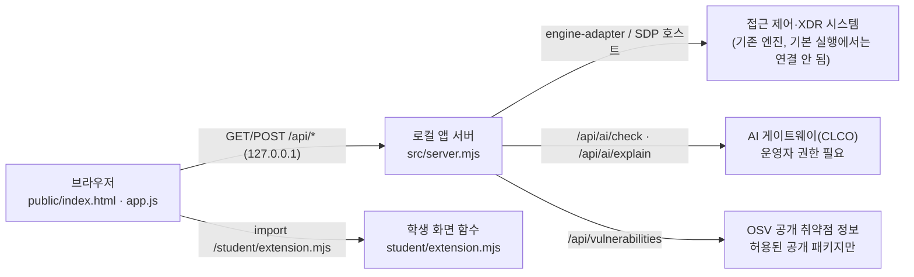

# 케셰브 학생 실행 설명서 (13~22단계, 학생 작성)

이 문서는 학생이 새로 쓴 문서입니다. 제공 문서(`README.md`, `docs/` 아래 다른 파일)는 고치지 않았습니다. 다른 사람이 이 문서만 보고 앱을 켜고, 끄고, 다시 켜고, 문제를 찾을 수 있게 정리했습니다. 확인하지 못한 것은 「미확인」으로 적었습니다.

## 1. 무엇을 만드는가

케셰브는 회사 직원이 자기 범위의 보안 상태만 보는 보안 앱입니다. 관리자용 전체 감시 화면이 아닙니다.

| 기능 | 화면 위치 | 학생 함수 | 단계 |
|---|---|---|---|
| 로그인 사용자·현재 기기·세션 상태 | 보호 현황 | `renderIdentity` | 13 |
| 업무 앱 한 개의 접근 판정·이유·시각 | 업무 앱 | `renderDecision` | 14 |
| 내 접속 기록·저장된 XDR 경보 목록, 필터 3개, 상세 | 보안 기록 | `renderEvents` | 15 |
| 알림·기기·세션·빈 화면·실패·도움정보 복사·미지원 조치 안내 | 보호 현황 | `renderStatus` (+ 15단계 상세) | 16 |
| 앱 안 AI 연결 점검 결과와 실패 원인 | 보호 현황 AI 연결 칸 | `renderAiConnection` | 17 |
| 근거·규칙·확인 불가 상태와 이어진 AI 사건 설명 | 보안 기록 | `renderExplanation` | 17~18 |
| 조치 제안·사람 확인·서버 접수(ACK)·효과 관측 구분 | 보안 기록 | `renderAction` | 19 |
| 설치 패키지의 정확한 버전과 OSV 조회 결과 | 보호 현황 | `renderVulnerabilities` | 20 |
| 내 PC 보안 대시보드(CPU·메모리·디스크·방화벽 카드, 네트워크·Windows 기록 건수, 조회 기록) | 보호 현황의 학생 상태 칸 맨 위 | `createPcDashboard` (`renderStatus` 에 붙임) | 총공세 |

## 2. 지원 환경과 버전

| 항목 | 값 | 확인 방법 |
|---|---|---|
| 운영체제 | Windows 11 Pro (PowerShell 5.1) | 학생 PC에서 실행해 확인 |
| Node.js | 24.19.0 (`package.json` 의 `engines.node`) | `node --version` 결과 `v24.19.0` 확인 |
| 시작 틀 | 0.2.21 (`package.json` 의 `version`) | 파일에서 확인 |
| 외부 npm 의존성 | 없음 (`on-client/package.json` 에 `dependencies` 없음) | 파일에서 확인 |
| 브라우저 | PC 브라우저, 1280px 이상 | 13단계에서 1400px 창으로 메뉴 이동 확인 |

지원하지 않는 것: 휴대폰 화면, Node.js 22 미만, 앱 폴더가 아닌 곳에서 실행, 링크(바로가기)로 연결된 폴더.

## 3. 폴더 구조

Git 저장소 최상위는 `choi-bujang-secret-vault` 이고, 케셰브 앱 폴더는 그 안의 `on-client` 입니다. 최상위의 `api/`, `public/`, `src/` 는 1~12단계 자료실(Vercel 배포)이며 케셰브와 따로 동작합니다.

```text
choi-bujang-secret-vault/          ← Git 최상위(커밋·제출 기준)
├─ README.md                       ← 1~12단계 + 4차 요약(학생 작성)
├─ api/ public/ src/ xdr/ ...      ← 1~12단계 자료실(케셰브와 별개)
└─ on-client/                      ← 케셰브 앱 폴더(PowerShell 을 여는 곳)
   ├─ package.json                 ← 제공: start / demo / check 명령
   ├─ .env.example                 ← 제공: 비밀 없는 설정 예시(ON_PORT=5189 등)
   ├─ student/extension.mjs        ← 학생 작성: 화면 함수 8개와 내 PC 보안 대시보드
   ├─ student/appearance.json      ← 학생 작성: 앱 이름·카드 배치(student-first)
   ├─ student/engine-adapter.mjs   ← 제공 그대로(고치지 않음)
   ├─ public/                      ← 제공: 화면 틀(index.html, app.js 등)
   ├─ src/server.mjs               ← 제공: 로컬 앱 서버(127.0.0.1)
   ├─ tools/start-alekov.ps1       ← 제공: 실행 도구
   ├─ docs/STUDENT_RUNBOOK.md      ← 학생 작성: 이 문서
   ├─ docs/STUDENT_QUICKSTART.md   ← 학생 작성: 처음 보는 사람용 한 장 안내
   ├─ docs/STUDENT_RELEASE.md      ← 학생 작성: 22단계 재현 기록
   └─ docs/STUDENT_DEMO.md         ← 학생 작성: 시연 순서와 한계
```

## 4. 실행·종료·다시 실행

1. 파일 탐색기에서 `choi-bujang-secret-vault\on-client` 폴더를 엽니다.
2. 주소 표시줄에 `powershell` 을 입력하고 Enter 를 눌러 그 폴더에서 PowerShell 을 엽니다.
3. 아래 명령을 실행합니다.

```powershell
powershell -NoProfile -ExecutionPolicy Bypass -File .\tools\start-alekov.ps1
```

4. 정상 시작 신호: `케셰브가 켜졌습니다. 브라우저에서 http://127.0.0.1:5189/ 을 여세요.`
5. 브라우저에서 `http://127.0.0.1:5189/` 를 엽니다. 위쪽 상태 표시와 「보호 현황」이 보이면 정상입니다. 기본 실행에서 「연결 없음」이 보이는 것은 정상입니다.
6. 종료: 실행한 PowerShell 창에서 `Ctrl+C`. 다시 실행: 같은 폴더에서 3번 명령을 다시 실행합니다.

포트 5189 를 다른 프로그램이 쓰고 있으면 그 프로그램은 그대로 두고 ` -Port 5190` 을 붙여 실행한 뒤 `:5190` 으로 엽니다.

예제 자료로 화면만 볼 때(실제 연결 아님):

```powershell
npm run demo
```

`src/server.mjs` 는 포트를 환경변수 `ON_PORT`(기본 5189)에서 읽습니다. 학생 확인 때는 5189 를 다른 프로그램이 쓰고 있어 `ON_PORT=5199` 로 `node src/server.mjs --demo` 를 실행해 `케셰브 예제: http://127.0.0.1:5199` 를 확인했습니다. 문법 검사는 `npm run check` 입니다.

## 5. 구성도



같은 내용을 글로 적으면 아래와 같습니다.

```text
[브라우저] ──/api/*──> [로컬 앱 서버 src/server.mjs] ──> [접근 제어·XDR 시스템(기존 엔진)]
     │                              ├──> [AI 게이트웨이(CLCO)]
     │                              └──> [OSV 공개 취약점 정보]
     └─ 제공 화면 app.js 가 서버 응답을 검사한 뒤 학생 함수(student/extension.mjs)에 넘김
        학생 함수는 DOM 요소를 돌려줌. 서버 조회는 대시보드의 「다시 조회」가 제공 통로 api.get('/api/pc/status') 로 읽는 것 하나뿐
```

| 서버 경로 | 쓰는 화면 |
|---|---|
| `/api/me`, `/api/devices`, `/api/sessions` | 13·16단계 사용자·기기·세션 |
| `/api/apps`, `/api/access` | 14단계 업무 앱 판정 |
| `/api/events` | 15단계 기록 목록 |
| `/api/diagnostics` | 16단계 도움정보 |
| `/api/ai/check`, `/api/ai/explain` | 17·18단계 AI 연결·설명 |
| `/api/actions/prepare`, `/api/actions/execute`, `/api/actions/result` | 19단계 조치(제공 화면 버튼만) |
| `/api/vulnerabilities` | 20단계 설치 패키지 조회 |
| `/api/pc/status` | 제공 카드 「내 PC 상태」, 학생 대시보드 「다시 조회」(읽기 전용) |

## 6. 제공 부분과 학생 작성 부분

| 구분 | 파일 | 하는 일 |
|---|---|---|
| 학생 작성 | `student/extension.mjs` | 8개 화면 함수와 내 PC 보안 대시보드. `createElement`·`textContent` 만 쓰고, 버튼은 15단계 상세·필터, 16단계 「도움정보 복사」, 미지원 조치 비활성 버튼, 대시보드 「다시 조회」만 만듭니다. 서버 조회는 「다시 조회」를 누를 때 제공 통로 `api.get('/api/pc/status')` 로 읽는 것뿐이고, 값을 재는 코드는 제공 서버(`src/pc-status.mjs`)입니다. |
| 학생 작성 | `student/appearance.json` | 앱 이름과 카드 배치만 정합니다. |
| 학생 작성 | `docs/STUDENT_RUNBOOK.md`, 최상위 `README.md` 의 4차 부분 | 이 설명서와 요약 |
| 제공 | `public/app.js`, `public/*.mjs`, `public/index.html` | 메뉴, 서버 요청, 응답 형식 검사, 다시 불러오기·취소·조치 버튼 |
| 제공 | `src/`, `tools/`, `vendor/` | 로컬 앱 서버, 엔진·AI·OSV 연결, 실행 도구 |
| 제공 | `student/engine-adapter.mjs` | 엔진 연결 어댑터(고치지 않음) |

## 7. 확인한 기능과 미확인 기능

| 기능 | 확인 방법 | 결과 |
|---|---|---|
| 13 사용자·기기·세션 표시, 다시 불러오기, 실패 시 옛 이름 제거, 메뉴 키보드 이동 | 예제 실행 화면 + 서버를 끈 실제 실패 | 확인 |
| 14 허용·거부·추가 확인 표시, 요청 실패와 거부 구분 | 예제 실행 화면(키보드 Enter 포함) | 확인. 확인 불가(unknown)는 모의 입력으로만 확인 |
| 15 최신순 정렬, 필터 3개, 상세, 빈 목록·실패 구분, `<b>` 글자 그대로 | 모의 입력(같은 페이지 DOM) + 서버를 끈 실제 실패 | 확인 |
| 16 빈 목록·실패·시간 초과 문구, 도움정보 6개 값만 복사, 미지원 조치 비활성, 자동 재요청 없음 | 모의 입력 + 실제 화면에서 다시 불러오기 | 확인 |
| 17 AI 연결 점검 상태·원인별 오류 안내 | 모의 입력 | 확인. 실제 계정 연결·AI 승인은 미확인 |
| 18 근거 ID 대조, 근거 불일치·executed 거부, 확인 불가 상태 | 모의 입력 + 예제 실행의 실제 실패(ON_AI_PROVISIONING_PENDING) | 확인. 실제 AI 설명 성공은 미확인 |
| 19 상태별 문구, effectApplied 없으면 결과 불명, 영수증·사건 불일치 거부 | 모의 입력 | 확인. 실제 조치 집행은 미확인(지원 조치 없음) |
| 20 정확한 버전, 범위 값 거부, 일부 실패 시 받은 ID 유지 | 모의 입력 + 예제 실행(not_configured) | 확인. 실제 OSV 조회는 미확인 |
| 대시보드 실측값 표시, 「다시 조회」 2회 기록 쌓임, 다시 불러오기 뒤 기록 유지, 서버를 끈 조회 실패 | 실제 화면(이 PC의 실측값, 1400px) | 확인. 권한 없음·시간 초과 분기는 코드만 읽음 |
| `tools/start-alekov.ps1` 로 실제 모드 실행 | 실행하지 않음 | 미확인 |

## 8. 문제가 생겼을 때

| 화면에 보이는 것 | 뜻 | 확인 방법 | 복구 |
|---|---|---|---|
| 「… 불러오기 실패: 로컬 서버에 연결할 수 없습니다. · 코드: NETWORK_ERROR」 | 앱 서버가 꺼졌거나 응답 없음 | PowerShell 창이 열려 있는지, 주소·포트가 맞는지 | 4장 명령으로 다시 켠 뒤 「다시 불러오기」를 직접 누름 |
| 「… 불러오기 실패(시간 초과)」 | 서버 응답 시간 초과(`TIMEOUT` 등) | 잠시 뒤 상태 표시 | 「다시 불러오기」를 직접 누름(자동 재요청 없음) |
| 「기록을 확인할 수 없습니다(확인 불가)」 | 응답 형식이 계약과 다름(`CONTRACT_MISMATCH`) | 「도움정보 불러오기」 → 「도움정보 복사」 | 복사한 값을 강사에게 전달 |
| 「AI 연결 점검 실패 · 원인: 권한 준비 중·확인 불가」 | 운영자 권한 발급 전(`ON_AI_PROVISIONING_PENDING`) | AI 연결 칸 | 학생 잘못이 아님. 담당자에게 권한 확인 요청 |
| 「원인: 인증 실패」「접근 제한」「반 사용량·이용 한도」「이용 시간 아님」「쓸 수 있는 모델 없음」 | `WB_CLCO_*`, `ON_AI_MODEL_LIST_EMPTY` 등 | AI 연결 칸의 코드 | 안내 문구대로 계정 연결 재확인 또는 담당자 확인 |
| 「AI 설명을 쓸 수 없습니다」 | 설명이 선택한 기록에 없는 근거를 인용했거나 실행됐다고 답함 | 보안 기록 상세의 근거 ID | 기록은 그대로. 다른 기록을 고르거나 다시 요청 |
| 「결과 불명(unknown)」(조치) | 효과 관측(`effectApplied:true`)이 없음 | 조치 칸의 영수증 ID | 「연동 시스템 결과만 재조회」. 같은 조치를 다시 보내지 않음 |
| 「조회 준비 미완료(not_configured)」(패키지) | 조회 대상 프로젝트가 설정되지 않음 | 패키지 칸 | 담당자가 준비. 취약점 없음이 아님 |
| `포트 5189 를 다른 프로그램이 쓰고 있습니다` | 다른 앱이 포트 사용 | 실행 도구 메시지 | ` -Port 5190` 으로 실행 |
| 대시보드 「조회 실패: … · 코드: NETWORK_ERROR」 | 앱 서버가 꺼짐 | 카드가 사라지고 지난 기록만 남는지 | 앱을 켠 뒤 「다시 조회」를 직접 누름 |
| 대시보드 「코드: PC_STATUS_STALE」 또는 `PC_STATUS_UNVERIFIED` | 측정 시각이 1분 넘게 지났거나 응답 형식이 다름 | PC 시계와 시작 틀 버전 | 시계를 확인하고 「다시 조회」. 계속되면 도움정보를 강사에게 전달 |
| 카드 「상태: 주의」 Windows 방화벽 | Private·Public 등 프로필이 꺼져 있음 | Windows 보안의 방화벽 화면 | 앱은 바꾸지 않음. 다른 보안 프로그램이 맡는지 사용자가 직접 확인 |

오류 코드 전체는 제공 문서 `docs/CONNECTION_TROUBLESHOOT.md` 에 있습니다.

## 9. 비밀값

열쇠·토큰·비밀번호는 이 저장소와 문서에 없습니다. 계정 연결 설정과 자격 보관소는 실행 도구가 프로젝트 밖의 Windows 사용자 폴더에 둡니다. `.env` 파일은 Git 에서 제외됩니다(최상위 `.gitignore`).
